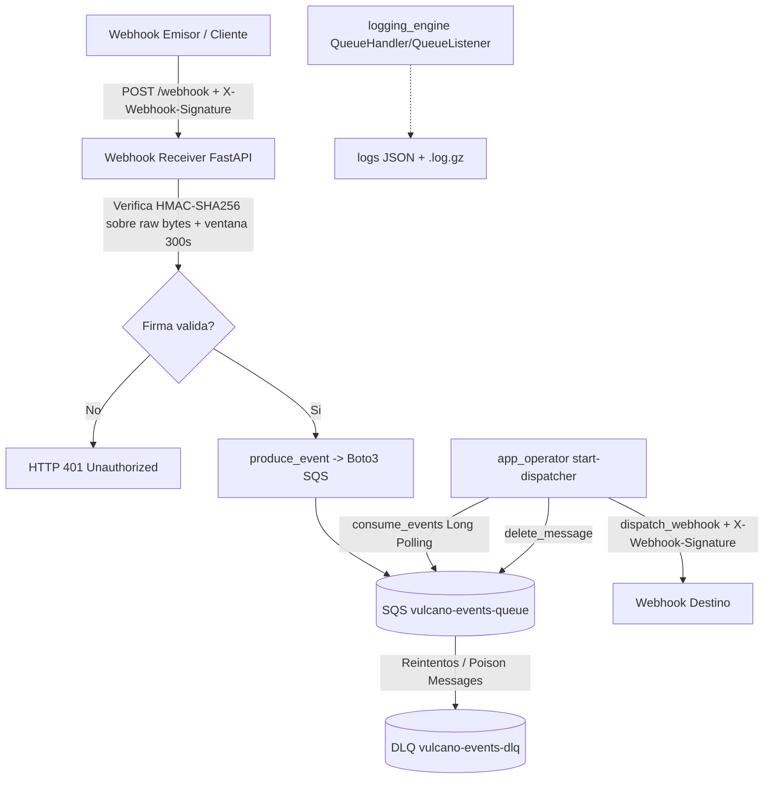

# TP-2: Sistema de Procesamiento de Eventos, Webhooks HMAC y Observabilidad Asíncrona con Boto3 y LocalStack (Proyecto Vulcano Pay)

## Integrantes

| Apellido y Nombre | Matrícula | Correo |
| ----------------- | --------- | ------ |
| Alegre Facundo Sebastian| ...       | ...    |
| Rodriguez Hector Fernando             | ...       | ...    |
| ...               | ...       | ...    |
| ...               | ...       | ...    |
| ...               | ...       | ...    |
| ...               | ...       | ...    |


## Roles

| #   | Rol                                                                       | Archivo(s)                                                                         | Integrante |
| --- | ------------------------------------------------------------------------- | ---------------------------------------------------------------------------------- | ---------- |
| 1   | Ingeniero de Robustez de Entradas, Excepciones y Sanitización             | src/vulcano_telemetry/exceptions.py, src/vulcano_telemetry/sanitizer.py            | ...        |
| 2   | Ingeniero de Mensajería Asíncrona SQS con Boto3 y LocalStack              | src/vulcano_telemetry/core_sqs.py                                                  | ...        |
| 3   | Ingeniero de Seguridad Criptográfica HMAC y Servidor Receptor de Webhooks | src/vulcano_telemetry/webhook_crypto.py, src/vulcano_telemetry/webhook_receiver.py | ...        |
| 4   | Ingeniero de Almacenamiento, Observabilidad y Logging Estructurado JSON   | src/vulcano_telemetry/logging_engine.py                                            | Alegre Facundo Sebastian|
| 5   | Coordinador de Integración, Despachador Webhook y CLI Engine              | src/app_operator.py                                                                | Rodriguez Hector Fernando        |
| 6   | Ingeniero de Simulación de Caos y Pruebas Forenses                        | tests/test_chaos.py, tests/test_forensic_log.py                                    | ...        |

## Arquitectura



## Instalación

```bash
python -m venv .venv
source .venv/bin/activate
pip install -r requirements.txt
cp .env.example .env
```

## Levantar LocalStack

```bash
docker compose up -d
```

## Uso

1. Publicar un evento de prueba a SQS:

```bash
python -m app_operator produce-sqs
```

2. Levantar el receptor de Webhooks:

```bash
python -m app_operator start-receiver
```

3. Levantar el despachador SQS -> Webhooks:

```bash
python -m app_operator start-dispatcher
```

## Tests

```bash
pytest -v
```
